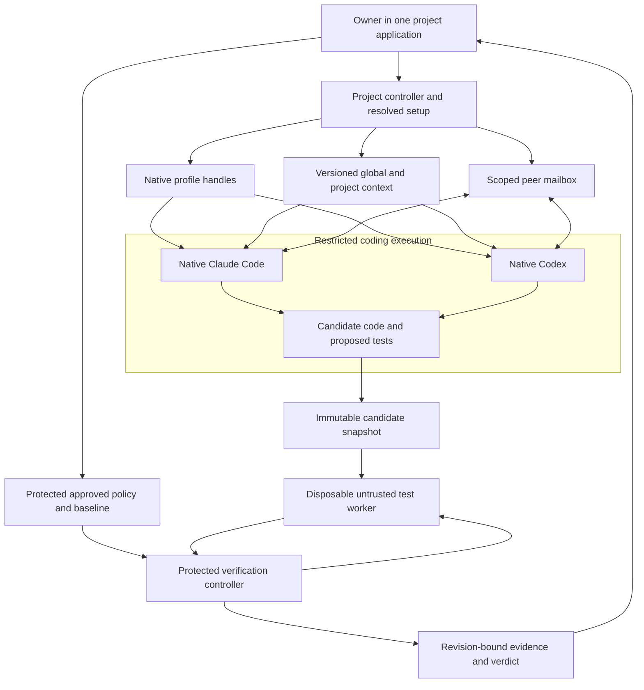

# Build one application around trustworthy completion

**Idea: Promising. Research: Good. Verdict: Build the integrated application, subject to a short qualification and a two-week use experiment.** The valuable product is one installed application where a project owns native harness sessions, shared context and setup, peer communication, account choices, and independent evidence about completed work. That is a stronger proposition than documenting how to assemble tools the owner already uses. Existing applications already integrate much of this experience, so the opportunity depends on making the whole project easier to operate and its completion claims easier to trust. A first macOS application using Claude Code and Codex is plausible; a November 30 beta covering useful parts of most feature areas is conditional. Delivering the strongest original interpretation of most of all fifteen features by that date is not supported by the evidence or capacity.

Research date: October 16, 2026. This assessment replaces the earlier framing and evaluates the corrected scope in [the decision record](../docs/agent-decisions.md). It uses the original research and renewed market, architecture and delivery notes. Competitor capabilities below are documented, not measured. No competing app, reuse foundation, authentication flow, sandbox or verifier was installed or qualified during this research.

## Integration is the product and already a category

The original research is **good problem and solution research**. It preserves specific owner frustrations, distinguishes requirements from findings, names primary sources, and records uncertainty. The owner already coordinates multiple native agents, worktrees, memory, skills, usage tools and sandboxes. That makes the setup and coordination problem concrete. Its strongest insight is that separately available capabilities still impose ongoing work when no application owns their relationship. A coherent project can preserve what was decided, what each harness knows, which account is active, what changed, and what the tests actually established.

It is not yet great validation research. The tool inventory is much richer than evidence about adoption, repeated usage, time saved or trustworthy completion. Stars and issue counts indicate attention and reported problems, not the number of people who would switch to this application. Several competitor snapshots also drift quickly. Traycer's original v1.4-era snapshot is behind its October 10 Desktop 1.5.1 release, and Superset now documents both account profiles and programmatic orchestration. These changes alter the competitive argument rather than just the inventory. ([Traycer releases](https://github.com/traycerai/traycer/releases/tag/desktop-v1.5.1), [Superset usage](https://docs.superset.sh/usage), [Superset orchestration](https://docs.superset.sh/orchestration))

There is direct first-party evidence for the integration problem: Databricks describes users keeping several agents open and copying information between them, then explains why it built Omnigent above existing harnesses. That validates the problem in one sophisticated engineering organization. It does not validate demand for another application or prove CrazyAgent would improve that workflow. ([Databricks announcement](https://www.databricks.com/blog/introducing-omnigent-meta-harness-combine-control-and-share-your-agents))

The first adopter should therefore be a developer already using both Claude and Codex on the same real project. The owner fits that profile. The initial test is whether one application reduces coordination and produces more dependable completion evidence than the owner's existing setup and at least one close integrated alternative. A public alpha should demonstrate the complete journey: create a project, apply shared global/project context, run both harnesses, exchange a useful message, verify code and test integrity, inspect the result, and reopen the project without reconstruction.

## Competitors already cover much of the proposed experience

The matrix distinguishes documented behavior from unknowns. A claim in documentation is not proof that a capability works reliably on the intended versions. An unknown is not an absent feature.

| Application | Integrated workflow already documented | Shared setup, accounts and communication | Verification boundary established by reviewed sources |
|---|---|---|---|
| **Traycer** | Tasks collect workspace folders, agents, artifacts, terminals, diffs and PRs | Shared-memory/context claims; global/workspace skills and scoped plugins; Claude/Codex profiles; explicit cross-agent messaging with native-interface limits | Separate evaluator and approved rubric workflow exists. Protected test rules and independently enforced execution remain unknown. |
| **Omnigent** | Native desktop/web/terminal over a common server/runner; mixed harnesses, policies and sandbox providers | Shared sessions/context; portable instructions and tool specifications; optional Hindsight memory; complete per-harness account UX and uniform native configuration remain unknown | Cross-vendor review and deterministic checks exist. Protected project-wide code-and-test authority remains unknown. |
| **Superset** | Repository/workspace, mixed CLI agents, changes, browser, tests and PR journey | Claude/Codex account profiles share setup; bundled orchestration creates agents and reads/sends terminal messages; consistent shared persistent project memory remains unknown | Tests and review appear in the workflow. Protected verifier policy and test-integrity enforcement remain unknown. |
| **JetBrains Air** | Several projects, agent sessions, IDE review and cloud environments | Project instructions, skills, commands and MCP configuration; arbitrary peer messaging and multiple identities per harness remain unknown | Separate agentic review exists. Rules inaccessible to coding agents and test-tampering protection remain unknown. |
| **Emdash** | Local/SSH projects, task worktrees, native CLI agents, diff/CI/PR/merge | Parallel native agents and lifecycle hooks; canonical memory, peer messaging and account-profile UX remain unknown | CI/review integration exists. Protected project verification remains unknown. |

Sources: [Traycer task model](https://docs.traycer.ai/concepts/tasks-and-workspace-folders.md), [Traycer README](https://github.com/traycerai/traycer/blob/main/README.md), [Omnigent](https://github.com/omnigent-ai/omnigent), [Superset](https://github.com/superset-sh/superset), [Air](https://www.jetbrains.com/air/), [Emdash](https://github.com/generalaction/emdash).

**Traycer is the closest experience competitor.** Its skills and profiles already address significant portions of the request. Its messaging documentation says chat agents can send and receive, while Codex Terminal can send but lacks an inbox. Its builder/evaluator workflow uses a user-approved spec and rubric; the documentation explicitly describes skills as instructions rather than an enforced pipeline. Consequently, shared context and a second evaluator are not defensible novelty claims. ([Traycer skills](https://docs.traycer.ai/settings/providers/skills.md), [Profiles](https://docs.traycer.ai/settings/providers), [Communication matrix](https://docs.traycer.ai/concepts/agent-to-agent.md), [Artifact workflow](https://docs.traycer.ai/concepts/artifact-workflow.md))

**Omnigent is the strongest runtime and governance comparison.** Its Polly cross-review already freezes a diff, runs deterministic checks and gives a different-vendor reviewer the contract and diff. That is useful prior art, although a workflow instruction does not itself establish a protected verification service. Its open centralized-MCP request also shows that native configuration placement remains a real integration concern; the issue alone cannot establish every current implementation gap. ([Polly cross-review](https://github.com/omnigent-ai/omnigent/blob/main/examples/polly/skills/cross-review/SKILL.md), [MCP issue #1352](https://github.com/omnigent-ai/omnigent/issues/1352))

Air is a distribution threat because it can place adjacent functionality inside an established developer environment. Superset removes any argument that multiple accounts or agent coordination are inherently missing from existing integrated apps. The resulting opportunity is narrower and more useful: **one understandable project state, with a completion result backed by checks that coding agents cannot rewrite.** Whether competitors already enforce that exact boundary remains unqualified. ([Air review](https://www.jetbrains.com/help/air/agentic-review.html), [Air settings](https://www.jetbrains.com/help/air/settings.html), [Superset orchestration](https://docs.superset.sh/orchestration))

## Reuse the application spine and protect the verifier

The fastest credible approach is to qualify one complete permissive application foundation. **Emdash is a strong local desktop candidate**: its Apache-2.0 repository includes the application, native PTY handling, SQLite, SSH and related integration packages. **Omnigent is a strong runtime/governance candidate**: its Apache-2.0 repository includes runtime/server and web code, with documented desktop, policy and execution surfaces. Neither was built or assessed for integration cost here. Compare pinned revisions on the actual full workflow; choose one spine rather than assembling several complete applications. Licensing alone does not qualify dependency obligations, trademarks, updater behavior, credentials or redistribution. ([Emdash license](https://github.com/generalaction/emdash/blob/main/LICENSE.md), [Desktop package](https://github.com/generalaction/emdash/blob/main/apps/emdash-desktop/package.json), [Omnigent license](https://github.com/omnigent-ai/omnigent/blob/main/LICENSE), [Runtime manifest](https://github.com/omnigent-ai/omnigent/blob/main/pyproject.toml))

Traycer's MIT license does not establish that its entire runtime is reusable: CONTRIBUTING describes clients, CLI and protocol, while the CLI uses signed released hosts. Qualify independent host availability before treating it as a full foundation. Superset uses Elastic License 2.0, so it should be evaluated under its actual source-available conditions rather than assumed interchangeable with Apache/MIT foundations. These are reuse constraints, not judgments about application quality. ([Traycer contributing](https://github.com/traycerai/traycer/blob/main/CONTRIBUTING.md), [Traycer license](https://github.com/traycerai/traycer/blob/main/LICENSE), [Superset license](https://github.com/superset-sh/superset/blob/main/LICENSE.md))

The app should own projects, task/session records, context versions, resolved configuration, profile handles, messages and verification jobs. Native harnesses should retain their execution and authentication responsibilities. Codex app-server supplies a documented local integration surface. For Claude subscriptions, the initial candidate is an embedded unmodified interactive Claude Code binary with each user's native login. An SDK/ACP wrapper does not automatically inherit that allowance; the SDK's third-party authentication rules must be assessed independently. `--bare` is also not a subscription shortcut: it skips OAuth/Keychain discovery and requires an API/cloud route. Never silently substitute API billing. ([Codex app-server](https://developers.openai.com/codex/app-server/), [Claude legal and compliance](https://code.claude.com/docs/en/legal-and-compliance), [Agent SDK overview](https://code.claude.com/docs/en/agent-sdk/overview), [Programmatic Claude Code](https://code.claude.com/docs/en/headless))

Canonical context should separate owner decisions, agent observations and observed verification results, with provenance and project scope. Compile global/project/session preferences into supported native forms and display exceptions. Portable skills or MCP definitions do not imply universal plugin, permission or hook parity; provider settings have their own precedence. Peer messaging should use bounded, project-scoped capabilities with authenticated sender identity and acknowledged delivery. It cannot grant policy-edit or account-store access. ([Agent Skills specification](https://agentskills.io/specification), [Claude settings](https://code.claude.com/docs/en/settings), [MCP security practices](https://modelcontextprotocol.io/docs/2025-11-25/tutorials/security/security_best_practices))

This is a proposed architecture, not an implemented security proof. A separate panel, process or directory is insufficient. Coding harnesses, subprocesses, plugins, host tools and candidate test scripts must have no write path to the verifier's approved policy, controller or accepted evidence store. Test workers must not receive host credentials, the Docker socket, unrelated projects or shared writable caches. Worktrees separate editing locations but share repository metadata. Existing sandbox infrastructure should enforce the supported boundary; qualify the host-side tools and gateways too. ([GitHub secure use reference](https://docs.github.com/en/actions/reference/security/secure-use), [Docker Sandboxes architecture](https://docs.docker.com/ai/sandboxes/architecture/), [SLSA build requirements](https://slsa.dev/spec/v1.2/build-requirements))

The verifier must independently run approved checks against an immutable candidate and record source, baseline, policy, tool/environment identities, discovered tests and observed results. New code or policy makes prior evidence stale. Candidate test changes remain proposals until owner disposition. Initial integrity evidence should include a broken implementation with always-pass tests that still fails a protected behavior check, detected weakening/removal, rejected policy edits and forged/stale results. Gauntlet is a relevant component candidate for baseline anchoring and integrity signals; its presence would not prove isolation or universal test correctness. A verifier can establish bounded claims about supported checks, not prove every arbitrary test is meaningful. ([Gauntlet](https://github.com/matthewjones372/gauntlet))

Multiple accounts should mean explicitly selected, isolated native profiles, with active identity and billing visible. Claude documents configuration-directory separation, including authentication caveats that need live testing. Consumer token collection and automatic quota evasion are different matters. Sign in with ChatGPT terms prohibit rotation or usage splitting to bypass limits. Manual profile selection does not fulfill original F5's automatic failover semantics. ([Claude authentication](https://code.claude.com/docs/en/authentication), [Sign in with ChatGPT terms](https://openai.com/policies/sign-in-with-chatgpt-terms/))

## Four integrated ideas earn their place through outcomes

**An evidence board can make completion inspectable.** Attach each requested outcome to its responsible sessions, source revision, context revision, protected checks and fresh/stale result. Existing review artifacts and Polly's frozen-diff review supply prior art. The additional value is connecting them to independently collected evidence in the project's daily workflow. Users should see exactly why the app considers a change verified, failed, stale or unsupported. ([Traycer review workflow](https://docs.traycer.ai/guides/review-agent-changes.md), [Polly](https://github.com/omnigent-ai/omnigent/blob/main/examples/polly/skills/cross-review/SKILL.md))

**A configuration preview can prevent silent divergence.** Before launch, show what each harness will receive from global defaults, project choices and session overrides, alongside unsupported parts. Rulesync and Traycer's scoped shared skills provide prior art. The product addition is one owner-visible explanation of the effective configuration and drift across active sessions, without overwriting existing provider files. ([Rulesync](https://github.com/dyoshikawa/rulesync), [Traycer skills](https://docs.traycer.ai/settings/providers/skills.md))

**A context conflict inbox can make shared memory credible.** If one session says an API is stable and another records a breaking change, retain both claims, source revisions and authorship. Request an owner decision only where needed; propagate its approved replacement. Shared memory already exists in competing products. The proposed improvement is explicit disagreement handling and scoped promotion, avoiding accidental conversion of one agent's speculation into a global instruction. This is a proposed design hypothesis, not a proven memory algorithm.

**A handoff preview can expose what actually transfers.** Before continuing a task with another harness, display the latest source, approved decisions, useful artifacts, unresolved questions and verified evidence, plus native state that cannot transfer. Traycer already rebuilds context through its integrated workflow; ACP supplies optional native session loading. The product distinction would be an inspectable loss boundary and stale-evidence handling, rather than a promise to migrate hidden reasoning or live subprocesses. Dynamic spawning and adaptive orchestration are separate, unapproved extensions. ([Traycer README](https://github.com/traycerai/traycer/blob/main/README.md), [ACP session setup](https://agentclientprotocol.com/protocol/v1/session-setup))

## The build decision depends on a working project

The proposed first public release is October 30, after approximately 22 implementation hours qualifying the application foundation, permitted native integration, shared context, bidirectional messaging and protected verification. Those hours are inside the first release budget. At 30-40 hours weekly, October 16-November 30 contains **192-256 gross hours across 32 weekdays**, or approximately **154-205 feature hours after a 20% quality/release reserve**, before holidays and time off. The linked [proposed roadmap](../docs/superpowers/plans/2026-10-16-integrated-application-roadmap.md) maps every original requirement and keeps the first-month experiment separate from later expansion.

The verdict reverses if the integrated workflow does not reduce coordination, the owner keeps leaving the app to operate core features, a close competitor satisfies the same need through a small extension, or permitted authentication and a protected verifier cannot coexist in a practical application. Delay the date or change the foundation if qualification fails. Do not preserve the date by replacing the application with a recipe or replacing independent verification with another prompt.

The useful open-source contribution could be a focused upstream extension, a coherent fork, or a small independent application. The decision should follow the shortest qualified route to the complete workflow. **Build the integrated experiment; earn the broader November beta through repeated real use.** That preserves the original idea while giving the owner an explicit point to stop investing if it fails to improve work.
