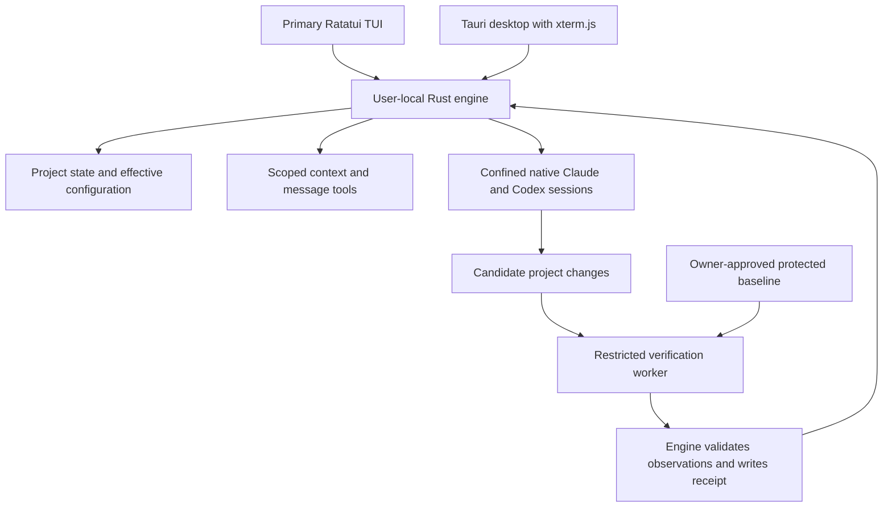

# Build Two Interfaces Around One Engine

Owner decision update after this research: DEC-007 in the [decision register](../docs/agent-decisions.md) selects a central CrazyAgent leader conversation that coordinates harnesses and sub-agents. The native-worker-interface-first recommendation below is superseded as the primary interaction. The researched components remain candidates, but structured control, leader orchestration, authority and scale require further grilling and qualification. The estimates below do not establish delivery effort for that clarified scope.

**Use Rust for CrazyAgent's main engine, Ratatui/Crossterm for its primary TUI, and Tauri 2 with xterm.js for its desktop interface, subject to qualification and owner decisions.** This is the strongest fit researched for one integrated project product across two interfaces. Tauri is a good candidate rather than a proven universal winner. Prefer maintained libraries and selected application modules; compare a bounded Vibe Kanban fork only if it demonstrably saves work despite its company shutdown and project-route sunset. Initially preserving both native harness interfaces through engine-owned PTYs offers the narrowest proposed route, while Codex app-server offers stronger structured control with additional interface work. Protected verification remains the hardest dependency. The added client makes October 30 a stretch integrated-demonstrator target; November 6 is a conditional public-alpha fallback, followed by an honest reforecast. These are recommendations, not accepted architecture or changed deadlines.

Research date: October 16, 2026. This synthesis draws on the current interface, engine and harness research plus the approved product roadmap. It establishes documented behavior and source-level reuse opportunities. It does not establish buildability, measured performance, native account access, terminal compatibility or an enforced verifier boundary. No implementation, authentication or sandbox qualification occurred during this research.

## One Rust owner gives both interfaces the same product

Rust fits a long-lived local process handling native children, bounded streams, project state and operating-system boundaries. Its value here is shared implementation and explicit resource ownership. It does not make provider processes, webviews or test execution safe automatically. The proposed application has one user-local engine, launched on demand, and two clients. Rust owns projects, sessions, identities, effective configuration, messages and verification state; the TUI and desktop render that state and submit validated operations. This avoids two databases, duplicated business rules and two independent launches of what the owner believes is one session.

Whether the engine outlives both clients is a product decision pending Q001. If accepted, explicit stop-session and stop-engine actions govern termination. The simplest alternative is a shared Rust library embedded separately in each UI, with a strict single-client product promise. That saves initial service-lifecycle work but changes session survival and simultaneous access. A persistent service is justified by those requirements, not by an assumed need for distributed architecture.

This is a logical dataflow, not proof of isolation. Only the trusted owner approves baseline changes. Candidate workers must lack access to engine control, policy and accepted receipts. Shared project memory cannot grant that authority.

Use versioned, bounded requests over Unix-domain sockets on macOS/Linux and owner-restricted named pipes on Windows. Validate peer identity, reject remote pipe clients and prevent endpoint impersonation. Default Windows pipe permissions are too broad for sensitive control. Local transport authentication still cannot contain an unsandboxed malicious process running as the same user. A reused foundation's authenticated loopback server is acceptable if it demonstrably saves work; a new thin host need not introduce HTTP. ([Tokio pipes](https://docs.rs/tokio/latest/tokio/net/windows/named_pipe/struct.ServerOptions.html), [Microsoft pipe security](https://learn.microsoft.com/en-us/windows/win32/ipc/named-pipe-security-and-access-rights))

The engine should persist critical state and request identities, issue a snapshot on reconnect, and resynchronize after an event gap. Keep high-volume terminal streams separately bounded so a slow desktop cannot stall a harness or the TUI. Tokio broadcast reports lag rather than providing durable replay. One client owns a session's keyboard and resize authority at a time; other clients observe or request ownership. ([Tokio broadcast](https://docs.rs/tokio/latest/tokio/sync/broadcast/index.html))

| Interface choice | Why it fits | Qualification or tradeoff |
|---|---|---|
| **Tauri 2 plus Ratatui/Crossterm** | Rust engine, web desktop controls and Rust terminal dashboard; permissive project licenses | Platform webviews differ. Ratatui is a dashboard library, not a terminal emulator. ([Tauri](https://tauri.app/concept/architecture/), [Ratatui](https://github.com/ratatui/ratatui), [Crossterm](https://github.com/crossterm-rs/crossterm)) |
| Electron plus the same Rust engine | Strong fallback when a qualified existing app or Chromium compatibility saves substantial work; MIT | Adds Node/main-process integration and bundled Chromium. No comparative latency or memory benchmark was performed. ([Electron](https://www.electronjs.org/docs/latest/tutorial/process-model)) |
| GPUI | Apache-2.0 Rust GUI toolkit with documented desktop platform support | Pre-1.0; terminal integration and accessibility need qualification. Its license does not cover every Zed component. ([GPUI](https://github.com/zed-industries/zed/blob/main/crates/gpui/README.md)) |
| egui/eframe or Iced | Credible all-Rust desktop alternatives under permissive licenses | No researched path established less total work than reusing xterm.js; that is a gap, not a limitation proved against either framework. ([egui](https://github.com/emilk/egui), [Iced](https://github.com/iced-rs/iced)) |
| Slint | Declarative UI with Rust bindings | GPLv3, royalty-free and commercial choices need deliberate selection; no established terminal-reuse advantage here. ([Licensing](https://github.com/slint-ui/slint/blob/master/LICENSE.md)) |

**Primary TUI does not mean inferior desktop functionality.** Both need the complete project journey, while navigation and presentation can differ. In the TUI, qualify a focused full-screen attachment to the native session before implementing nested terminal panes. Detach must restore the dashboard and physical terminal correctly. Desktop can reuse xterm.js. Unicode, paste, focus, IME, interrupt, resize and approval prompts require real tests; platform support in a crate is insufficient.

## Reuse a qualified foundation before creating application plumbing

**Vibe Kanban is the first whole-application candidate to examine.** Its current Apache-2.0 workspace includes `crates/tauri-app`, `crates/server`, `crates/executors`, `crates/worktree-manager`, `crates/db` and a local web frontend. That is a more direct match to Rust plus Tauri than the previously considered Python or Electron foundations. ([Workspace](https://raw.githubusercontent.com/BloopAI/vibe-kanban/main/Cargo.toml), [Tauri package](https://raw.githubusercontent.com/BloopAI/vibe-kanban/main/crates/tauri-app/Cargo.toml), [license](https://raw.githubusercontent.com/BloopAI/vibe-kanban/main/LICENSE))

It is not ready-made CrazyAgent. Its desktop starts an Axum server tied to application lifecycle; executors depend on internal crates and pinned protocol dependencies. The Claude adapter constructs a version-pinned `npx` invocation and streamed mode. Permission-bypass options, existing localhost exposure and permissive CSP terms require review rather than inheritance. A hidden window keeping work alive does not establish an independently owned engine. ([Desktop startup](https://raw.githubusercontent.com/BloopAI/vibe-kanban/main/crates/tauri-app/src/main.rs), [configuration](https://raw.githubusercontent.com/BloopAI/vibe-kanban/main/crates/tauri-app/tauri.conf.json), [Claude executor](https://raw.githubusercontent.com/BloopAI/vibe-kanban/main/crates/executors/src/executors/claude.rs), [executor dependencies](https://raw.githubusercontent.com/BloopAI/vibe-kanban/main/crates/executors/Cargo.toml))

The April 10 shutdown announcement says Bloop closed and intended community continuation. Local workspaces remain usable, while remote kanban issues, comments, projects and organizations were removed from the supported product route. The latest stable release researched, April 24's `v0.1.44-20260424091429`, describes project routes becoming export-only. Current main includes a September 19 community commit, so neither "no development since April" nor "unchanged company support" is accurate. The maintainer discussion asks who will contribute maintenance time. **Selective reuse is the safer default; a full fork requires explicit maintenance ownership and a qualified project model.** ([Announcement](https://www.vibekanban.com/blog/shutdown), [stable release](https://github.com/BloopAI/vibe-kanban/releases/tag/v0.1.44-20260424091429), [inspected main revision](https://github.com/BloopAI/vibe-kanban/commit/d5cbb5380fa0b32e98ef9b8d987f63decce4be3a), [community discussion](https://github.com/BloopAI/vibe-kanban/discussions/3424))

Compare a constrained extension/fork against selected modules and a thin host at a frozen revision. The winner must preserve local operation, native auth, two clients and protected verification with fewer changes and dependencies. Keep working spike code. If Vibe Kanban qualifies, retain its SQLx storage rather than introducing rusqlite alongside it. For an independent small core, one rusqlite worker is simpler; both libraries are credible, and SQLite remains a single-writer local database. ([SQLx](https://github.com/transact-rs/sqlx), [rusqlite](https://github.com/rusqlite/rusqlite), [SQLite WAL](https://sqlite.org/wal.html))

| Existing application | Reuse recommendation | Constraint |
|---|---|---|
| Vibe Kanban, Apache-2.0 | Selective modules by default; bounded full-spine comparison | Sunset project routes, maintenance ownership, TUI, independent lifetime and protected authority remain work |
| Agent of Empires, manifest `MIT AND Apache-2.0` | Strong TUI/session/worktree reference, especially `src/tui` and `src/tmux` | tmux persistence targets Unix; native Windows and module-specific notices need separate treatment. ([Manifest](https://github.com/agent-of-empires/agent-of-empires/blob/main/Cargo.toml), [docs](https://www.agent-of-empires.com/docs/index.html)) |
| Emdash, Apache-2.0 | Desktop/worktree/terminal UX and selected modules; Electron fallback candidate | Its Node/Electron engine is not a Rust library. ([Repository](https://github.com/generalaction/emdash)) |
| Omnigent, Apache-2.0 | Shared-session, policy and adapter patterns | Python runtime adds another engine language and authority owner. ([Manifest](https://github.com/omnigent-ai/omnigent/blob/main/pyproject.toml)) |
| Superset, Elastic License 2.0 | Study workflow and account UX | Source availability is not permissive OSI licensing; copying requires applicable terms review. ([License](https://github.com/superset-sh/superset/blob/main/LICENSE.md)) |

| Component | Build, reuse or defer | License and limit |
|---|---|---|
| Runtime and wire data | Reuse Tokio, Serde and serde_json | MIT / MIT-or-Apache-2.0. Build only CrazyAgent's narrow operations, bounds and state rules. ([Tokio](https://github.com/tokio-rs/tokio), [Serde](https://docs.rs/serde/latest/serde/)) |
| Native PTY | Qualify WezTerm's portable-pty | MIT; provides spawn, terminal I/O, resize and ConPTY, not emulation or confinement. ([API](https://docs.rs/portable-pty/latest/portable_pty/)) |
| Terminal rendering | Reuse xterm.js; defer nested TUI panes unless needed | MIT xterm.js; MIT tui-term/vt100 candidate is work in progress. ([xterm.js](https://github.com/xtermjs/xterm.js), [tui-term](https://github.com/a-kenji/tui-term)) |
| Repository operations | Reuse installed Git initially | Keep repository-controlled hooks/filters outside trusted engine operations; worktrees share metadata. ([Git worktrees](https://git-scm.com/docs/git-worktree), [configuration](https://git-scm.com/docs/git-config)) |
| Context, config and message tools | Reuse Agent Skills, Apache-2.0 `rmcp`, and qualify MIT Rulesync | These supply formats/protocols/transforms. CrazyAgent still owns scope, conflict and authority semantics. ([Skills](https://agentskills.io/specification), [rmcp](https://github.com/modelcontextprotocol/rust-sdk), [Rulesync](https://github.com/dyoshikawa/rulesync)) |

Do not copy Zed's GPL terminal wrapper assuming it shares GPUI's Apache license. Do not import Codex's entire workspace merely to reuse TUI widgets. Pin selected dependencies, preserve notices and review file-level provenance. A Rust engine can use web UI code and an external runtime without becoming an all-Rust product. ([Zed terminal manifest](https://raw.githubusercontent.com/zed-industries/zed/main/crates/terminal/Cargo.toml), [Codex TUI dependencies](https://raw.githubusercontent.com/openai/codex/main/codex-rs/tui/Cargo.toml))

## Preserve native harness behavior while integrating project state

The recommended first path is **one engine-owned native Claude or Codex PTY process per session**, preserving its UI and native approval dialogue. Desktop and TUI attach to that run; neither starts a second inference process as a renderer. Terminal text cannot establish reliable structured tool state or trustworthy verification. Same-session reattachment, including screen recovery, remains unqualified.

Codex app-server is the strongest structured alternative: documented initialization, threads, history, turn control, approvals and account operations over local stdio. It requires custom chat, approval and history views in both clients. A bounded implementation can be worthwhile if the owner values uniform controls above native UI breadth, but it is additional work. An experimental remote transport or native remote flag does not prove two views attach safely to the same thread. ([App-server](https://developers.openai.com/codex/app-server/), [CLI reference](https://developers.openai.com/codex/cli/reference))

Claude's published hosting conditions allow users to authenticate directly inside a hosted unmodified binary, while restricting developer collection or intermediation of Claude.ai tokens. Current help also says SDK and `claude -p` subscription usage continues while an announced change is paused. Therefore neither blanket SDK permission nor blanket programmatic prohibition is accurate. Qualify the exact distributed integration and auth mode. `--bare` is unsuitable for the normal shared-context subscription path: it skips subscription/OAuth/Keychain and discovery of core context/configuration. Never silently switch to API billing. ([Hosting conditions](https://code.claude.com/docs/en/legal-and-compliance), [subscription guidance](https://support.claude.com/en/articles/15036540-use-the-claude-agent-sdk-with-your-claude-plan), [bare mode](https://code.claude.com/docs/en/headless#start-faster-with-bare-mode))

Native profiles remain provider-owned. Claude documents separate `CLAUDE_CONFIG_DIR` identities with an exception for certain Console sign-ins. Codex storage can be file, keyring or other configured modes; a separate `CODEX_HOME` does not prove all concurrent logout behavior is isolated. Advertise multiple accounts only after login, refresh, logout, history and concurrent-use tests pass. ([Claude auth](https://code.claude.com/docs/en/authentication), [Codex auth](https://developers.openai.com/codex/auth))

ACP should remain an expansion option. Its Apache-2.0 Rust SDK is reusable protocol machinery; current Codex ACP is a TypeScript/Bun sidecar over app-server, and Claude ACP is a Node/SDK adapter. They add runtime and capability mapping, not new provider rights. ([ACP Rust](https://github.com/agentclientprotocol/rust-sdk), [Codex adapter](https://github.com/agentclientprotocol/codex-acp), [Claude adapter](https://github.com/agentclientprotocol/claude-agent-acp))

Shared memory means canonical project facts with provenance and revision, plus explicit global/project precedence. Rulesync can reduce mapping work but its support matrix distinguishes native, simulated and scope-specific behavior. Unsupported plugins, permissions or commands must remain visible. Use scoped MCP context/mail tools with engine-derived sender identity, bounded delivery and idempotency; do not let a message authorize policy changes. This is application integration, not an approved autonomous swarm. ([Rulesync matrix](https://rulesync.dyoshikawa.com/reference/supported-tools), [MCP Rust SDK](https://github.com/modelcontextprotocol/rust-sdk))

## Verification protection determines the real platform boundary

**A separate process, database directory or Tauri capability file does not protect the verifier from an unsandboxed same-user coding agent.** That agent can reach owner-writable policy, executables or control channels. Tauri capabilities govern webview access to core commands, not whole-child operating-system confinement. ([Tauri security](https://tauri.app/security/))

Qualify confinement around the entire native harness and every tool/plugin/MCP child, then separately restrict candidate build and test execution. Keep engine control, approved baselines and accepted receipts outside both write authorities. Anthropic sandbox-runtime is the first reusable native-boundary candidate: macOS Seatbelt, Linux isolation and current Windows alpha support. Its Node ecosystem and platform prerequisites add packaging costs. Native login/Keychain, PTY input/resize and safe host integration inside that boundary remain decisive unknowns. Do not enable broad host sockets or application automation simply to make login work. ([Runtime and prerequisites](https://github.com/anthropics/sandbox-runtime/blob/main/README.md))

Docker's standalone sbx is an optional stronger microVM fallback, not a settled dependency. Local requirements include supported hardware/OS virtualization and Docker sign-in; guest toolchains and credential/configuration behavior differ. Its Codex route documents different internal approval defaults. Public availability does not establish open-source redistribution rights. Qualify those obligations, native subscription flows and resource costs before choosing it. ([Requirements](https://docs.docker.com/ai/sandboxes/install/), [isolation](https://docs.docker.com/ai/sandboxes/security/isolation/), [Codex behavior](https://docs.docker.com/ai/sandboxes/agents/codex/), [FAQ](https://docs.docker.com/ai/sandboxes/faq/))

Verification must bind the captured candidate, approved policy and observed execution to an engine-written receipt. Candidate code, test setup and report files are untrusted. A hash or exit zero alone does not establish authenticity. Required pilot cases include deleted protected tests, changed thresholds, unexpected zero tests, planted results, policy-write attempts, and broken code paired with always-pass tests. Gauntlet's Apache-2.0 detectors and tampering corpus are useful candidates; its own evidence includes false positives. Negative controls demonstrate sensitivity to exercised failures, not universal correctness of tests. Source edits make prior evidence stale. ([Gauntlet](https://github.com/matthewjones372/gauntlet), [published evidence](https://github.com/matthewjones372/gauntlet/blob/main/docs/evidence.md))

| Platform target | What sources support | What CrazyAgent must still qualify |
|---|---|---|
| macOS | Tauri/Rust/native harness routes; native confinement candidate | First release target: auth, PTYs, protected authority, packaging and another real Mac |
| Linux | Rust/Tauri and native agents; distro/kernel-dependent sandbox options | WebKitGTK, terminal behavior, credential stores, prerequisites and enforcement |
| Windows | Tauri/WebView2, ConPTY and native harness operation | Pipe ACLs, paths, profiles, subprocess cleanup and a common protected boundary |

Native Claude Windows operation is distinct from WSL2 sandbox support; Codex has its own native Windows sandbox options. A provider-specific sandbox is not automatically a common boundary for both harnesses. A Linux worker cannot qualify native macOS UI tests or native Windows behavior. **Cross-platform architecture now, qualified combinations incrementally** is credible; November parity across every OS is not established. ([Claude setup](https://code.claude.com/docs/en/setup), [Codex Windows](https://developers.openai.com/codex/windows), [Tauri webviews](https://tauri.app/concept/architecture/))

## Qualify the dual-client core before preserving dates

V1 must let either client create/select a project, launch and inspect both harnesses, apply supported shared state, exchange messages, handle native approvals, run protected verification and display current/stale/failed evidence. Begin with one pilot toolchain and one qualified profile per harness; prove multiple profiles next. Cut extra terminal panes, third harness, picker and advanced analytics before this core or the trust boundary.

| Qualification slice | Provisional owner hours | Required evidence |
|---|---:|---|
| One owner with both clients | 5-7 | Same state/session; correct lifetime; no duplicate start or conflicting input |
| Native routes and profiles | 6-10 | Real auth, approvals, input, resize and profile isolation |
| Shared state and messages | 4-6 | Supported context and two-way scoped delivery visible in both clients |
| Protected verification | 10-14 | Actual confinement, tamper rejection, negative control and protected receipt |
| Recovery and packaging feasibility | 4-7 | Reconnect/resynchronization and explicit dependency/platform inventory |

**The 29-44-hour qualification envelope replaces the previous 22 hours.** These are decision-limited timeboxes, not a delivery guarantee. The suggested four-hour foundation comparison and twelve-hour interface sub-budget overlap this envelope; do not add all three totals. If build prerequisites consume a timebox, record the gap and reforecast rather than declaring qualification complete.

The previous 26-44 productization hours plus this envelope imply roughly **55-88 feature hours**, still provisional and overlapping retained spike work. Available feature capacity is approximately 53-70 hours through October 30 and 77-102 through November 6. Even the fallback cannot guarantee the upper estimate at 30 hours/week. Preserve the existing 20% reserve for required checks, review/fixes and release work; do not charge those hours twice or consume them to rescue dates. The full period still offers roughly 154-205 feature hours before holidays/time off.

Recommend October 30 as a stretch integrated demonstrator, November 6 as a conditional public-alpha fallback, and November 30 as a conditional broader macOS beta. If usable real-use alpha starts November 6, the two-week expansion decision moves to November 20. November 13 remains a checkpoint rather than a falsely completed two-week experiment. Reforecast after qualification and preserve mandatory engineering/review gates. No implementation or scan is claimed complete by this research.

The next decisions should follow dependencies, recorded individually with stable IDs, status, rationale, rejected alternatives, risks and acceptance criteria. DEC-001 through DEC-003 already capture owner requirements; the following remain candidates, not approvals.

| Candidate topic | Recommended starting position | Dependency |
|---|---|---|
| Session lifetime | Background engine; explicit stop | Determines whether a persistent owner is needed |
| Client ownership and native UI | Same sessions, one input/resize owner; native-first PTYs | Determines attach protocol and two-client UI work |
| Trust boundary and auth | Qualify whole-process confinement without weakening native auth | Can invalidate foundation or date |
| Foundation and framework | Vibe Kanban comparison; Rust/Ratatui/Tauri hypothesis | Select after the preceding requirements |
| Release acceptance | Both complete client journeys, one pilot toolchain, macOS first | Sets scope, qualification evidence and forecast |

Q001 is prepared but unanswered: **Should running agents continue on the same computer after you quit both the TUI and desktop application?** Recommendation: yes, with explicit stop actions and visible background status. The tradeoff is additional local-engine lifecycle and recovery work; answering no permits a simpler client-bound lifetime but closing the interface can end work. Resolve this one question before the next grilling branch, and persist the answer immediately in the numbered decision register.
