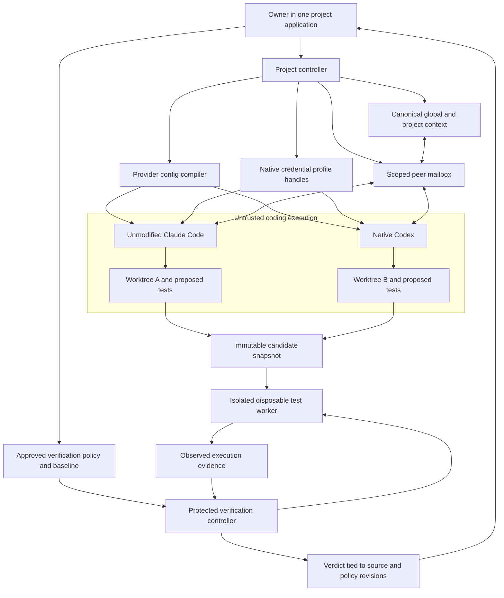

# Integrated project application: architecture and delivery feasibility

Research date: October 16, 2026. Scope: the owner's corrected product, including both product-code verification and test-integrity checks, with coding harnesses prevented from changing trusted verification rules. The entire original research document and the corrected `docs/agent-decisions.md` were read. The existing graph was queried first. No implementation, account access, package installation, or global configuration changes were performed.

## Can one application preserve native harnesses while owning the project experience?

### Takeaway

Yes, this is technically credible. The product should own projects, shared state, integration, and verification, while preserving each native harness's execution and authentication boundaries. This is a substantially stronger application concept than a launch utility or a configuration recipe. Existing tools already overlap heavily with its presentation and orchestration, so the complete integrated experience must be demonstrated rather than assumed unique.

### Cited Findings

- Codex app-server explicitly supports embedded product integrations with authentication, conversation history, approvals, and streamed events. Its account surface exposes native login and rate-limit methods. Its documentation expressly allows continued local/open-source use of app-server authentication, recommends Sign in with ChatGPT, and excludes commercial or hosted services from that authentication allowance. Its WebSocket transport is described as experimental. Prefer local process transport initially. [Codex app-server](https://learn.chatgpt.com/docs/app-server)
- Anthropic permits products to run the unmodified Claude Code binary subject to its stated conditions, with each end user authenticating through their own native flow and usage billed directly to them. The same page prohibits developers from collecting, storing, or intermediating consumer credentials or offering their own claude.ai login. These are distinct integration cases. [Claude Code legal and compliance](https://code.claude.com/docs/en/legal-and-compliance)
- The Claude Agent SDK overview independently says third-party products must not offer claude.ai login or rate limits without prior approval and directs developers to API-key authentication. A wrapper or ACP adapter using the SDK does not automatically inherit permission to use consumer subscriptions merely because underlying components overlap with Claude Code. [Agent SDK overview](https://code.claude.com/docs/en/agent-sdk/overview)
- Claude Code supports structured CLI output and explicit settings/MCP/plugin inputs. However, `--bare` skips automatic project/global discovery and does not read subscription OAuth credentials or the macOS Keychain. Normal `-p` execution can load project hooks/MCP without an interactive workspace-trust dialog. These behaviors materially affect safe embedding. [Programmatic Claude Code](https://code.claude.com/docs/en/headless)
- ACP defines client/agent capability negotiation, prompting, permission requests, cancellation, and optional session loading. Session setup supports working-directory and MCP-server inputs. This is useful transport reuse, not a guarantee of identical configuration, authentication, memory, or process recovery across harnesses. [ACP overview](https://agentclientprotocol.com/protocol/v1/overview), [ACP session setup](https://agentclientprotocol.com/protocol/v1/session-setup)
- Agent Skills specifies a portable `SKILL.md` structure. Claude's actual settings have user, shared-project, project-local, command-line, and managed tiers, plus array-merging exceptions. A simple universal last-write-wins configuration model would misrepresent effective behavior. [Agent Skills specification](https://agentskills.io/specification), [Claude settings precedence](https://code.claude.com/docs/en/settings)
- Omnigent already advertises native desktop access, combined harnesses, policies, sandbox providers, and synchronized sessions, under Apache-2.0. Its native and SDK harness choices require separate evaluation. Its harness test bench is especially relevant to qualification. Its existence supports reusing infrastructure while also raising the competitive bar. [Omnigent repository](https://github.com/omnigent-ai/omnigent)
- Rulesync supports import/generation across Claude and Codex rules, skills, MCP, hooks, and other formats, with mode-specific limits explicitly documented. AgentAPI provides an HTTP wrapper through terminal emulation and parsing, which offers a compatibility escape route but less authoritative event semantics than native structured interfaces. [Rulesync](https://github.com/dyoshikawa/rulesync), [AgentAPI](https://github.com/coder/agentapi)

### Inferences

#### Recommended integration boundary

Use a single macOS application with a local project controller. The application remains the user's one place to create a project, choose harnesses and profiles, share context, communicate, inspect work, and obtain verification results. A terminal pane inside that application is compatible with the product thesis if the project controller provides the integration; opening two unrelated terminal windows is not the product.

For the first subscription-backed Claude integration, the conservative design is an embedded PTY running the official unmodified interactive CLI, with native login and permission prompts preserved. This follows the documented native-hosting route. Treat stream-json/SDK/ACP-based consumer integration as a qualification question rather than a granted entitlement. An API-backed SDK mode may be offered separately only with explicit billing choice and clear labeling. Do not silently switch the owner's subscription workflow to API billing. For Codex, qualify its documented local app-server integration and keep the actual Codex harness and native authentication in charge.

The UI toolkit is not the core research decision. Reuse an existing viable application shell or a familiar desktop framework after a short qualification. Do not spend the first week building a terminal emulator, a new agent loop, or a new durable-workflow engine.

#### State the application should own

| Application record | Purpose and ownership |
|---|---|
| Project | Stable project ID, repository roots, project state, workspace registrations, verification policy association |
| Session | Native harness/session ID, harness version, selected credential-profile handle, worktree/branch, task, status, permissions, configuration revision |
| Canonical context | Owner decisions, project facts, memory entries with provenance/version, artifact references, task progress, peer messages |
| Configuration | Global defaults, project overlays, session choices, pinned skills/plugins/MCP definitions, provider-specific overrides and unsupported fields |
| Verification job | Exact candidate snapshot, approved policy revision, baseline revision, runner/tool versions, execution status, evidence, disposition |

Start with a transactional local store and ordinary files for human-editable content. Semantic search, graph memory, and cloud synchronization are later implementation choices. Shared memory needs reliable identity, provenance, conflict behavior, and retrieval before it needs a novel memory algorithm.

The app's desired precedence can be global -> project -> session, with owner-controlled security restrictions outside that override chain. Compile desired settings into each provider's supported form and show the actual resolved result. Provider and organization policy still wins where required. Preserve existing user files through explicit import and application-owned generated output; do not rewrite entire global provider configuration files.

A plugin is one application-managed package with supported provider realizations, rather than a promise that every provider executes every plugin component. Skills and MCP definitions are the first portable pieces. Expose provider-only hooks, agents, permissions, and unsupported fields openly. Pin source and version, show what is installed for each harness, and require explicit trust for executable additions.

Shared memory and owner policy require different write paths. Harnesses may propose or append project observations with authorship and revision checks. They must not overwrite approved owner decisions or the verifier's policy. Global memory must not automatically ingest private project data. Avoid feeding every transcript to every harness; use bounded task context and references to exact artifacts, with visible provenance. Native conversation state remains provider-owned. A portable task record is not a serialized live model runtime.

#### Peer communication

Expose a small application-controlled mailbox through supported native tools, initially MCP: list permitted peers, send a message, read inbox, acknowledge. Derive sender/project/session identity from the session's granted capability, never from agent-supplied identity strings. Scope access to one project and explicit recipients. Bound payload size, queue depth, delivery rate, and expiry. Persist message IDs and acknowledgments so reconnecting does not duplicate actions.

Messages are untrusted peer content, not owner instructions or verification-policy updates. Their references should include worktree and source revision to prevent one harness applying advice to the wrong tree. Reject cross-project sends and attempts to address protected controller/verifier operations. Start with user-directed sessions and peer messages; automatic agent spawning, routing loops, and dynamic workflow orchestration require the owner's separate explicit approval.

#### Component and trust-boundary diagram

The arrows are proposed data flows, not evidence of an implemented security boundary. Coding execution, plugin processes, and candidate test execution must have no write path to verification authority, controller executable/configuration, profile storage, or final result storage. Communication tooling must not accidentally grant such a path.

### Gaps

No adapter, UI shell, reuse foundation, profile flow, or sandbox was executed or qualified in this research. The file directory currently has no Git repository or implementation. The native PTY approach preserves the clearest subscription boundary but requires a real compatibility spike for messaging, status extraction, input behavior, and safe lifecycle control. There is no basis yet for promising identical capabilities or transparent subprocess migration across providers.

## What makes verification independent, and how should multiple accounts work?

### Takeaway

The independent verifier is a meaningful application feature only if coding harnesses cannot alter its authority, environment, or accepted evidence. A different prompt, another agent, a sibling directory, and a fresh process are insufficient guarantees. Multiple accounts should begin as explicit native profiles with separate execution contexts, not a quota-rotation pool.

### Cited Findings

- SLSA separates trusted control-plane provenance from user-defined build steps and describes isolation against cross-job influence and persistent environment contamination. This is a useful architecture model for protecting verification evidence; it does not make this proposed app SLSA compliant. [SLSA build requirements](https://slsa.dev/spec/v1.2/build-requirements)
- GitHub warns that untrusted workflow code can persistently compromise self-hosted runners and reach accessible credentials. Reusing a host without sufficient isolation is therefore not made safe by starting a new test process. [GitHub secure use reference](https://docs.github.com/en/actions/reference/security/secure-use)
- Gauntlet documents baseline-anchored configuration, its own fresh execution evidence, checks for deleted/skipped/weakened tests, and coverage/mutation/test-count ratchets. Its holdout documentation explicitly says repository-resident holdouts are hidden rather than secret. This is a candidate verifier component, not proof that arbitrary tests are correct or that host isolation is solved. [Gauntlet](https://github.com/matthewjones372/gauntlet)
- Claude's sandbox distinguishes model tool permissions from OS-enforced subprocess filesystem/network restrictions. Excluded commands run outside the sandbox. Writable configuration or host-side tools can therefore change the effective protection. [Claude sandboxing](https://code.claude.com/docs/en/sandboxing)
- Docker Sandboxes describes microVM execution, host-side credential/network handling, and a host-side MCP gateway. Local MCP servers run on the host, not inside the sandbox VM. Thus even a VM-based agent sandbox requires an explicit tool/gateway boundary. [Docker Sandboxes architecture](https://docs.docker.com/ai/sandboxes/architecture/)
- MCP security guidance requires authenticating requests rather than treating session IDs as authentication, binding identity to authenticated context, minimizing scopes, and limiting proxy process privileges. It also describes host command execution risks in MCP proxies. [MCP security best practices](https://modelcontextprotocol.io/docs/2025-11-25/tutorials/security/security_best_practices)
- Claude's official authentication page documents simultaneous personal/work accounts using separate `CLAUDE_CONFIG_DIR` directories and directory-keyed macOS Keychain entries. It identifies an exception for certain Console sign-ins stored outside that directory. Environment credentials also have precedence that can change billing. Documented configuration separation still needs live isolation tests on supported versions. [Claude authentication](https://code.claude.com/docs/en/authentication)
- Sign in with ChatGPT terms specifically prohibit account rotation and usage splitting to bypass limits, and require persistent authentication-token storage to remain local and under user control. This is a distinct integration agreement from native CLI use; do not collapse the two into a universal statement that all multiple-account selection is forbidden or that automatic rotation is allowed. [Sign in with ChatGPT terms](https://openai.com/policies/sign-in-with-chatgpt-terms/)

### Inferences

#### Minimum verification authority

The owner enrolls a project with a known baseline and approves the runner, commands, relevant environment, expected test discovery, and baseline tests. The trusted policy is stored and versioned outside coder-writable areas and cannot be changed through peer messages or shared memory. Test-policy changes require a visible owner approval flow. Protect controller binaries, runner binaries, environment selection, executable search paths, hooks, dependency resolution, and result persistence as part of this boundary.

Coders may add or propose changes to tests. A test change does not become a new trusted baseline merely because its author says it is necessary or the new suite is green. Report the proposed change separately, run applicable approved baseline checks against the candidate, and require owner disposition for weakening/removal or incompatible baseline changes. Legitimate API changes can make older tests incompatible; label that condition explicitly rather than forcing a false pass or permanently prohibiting test maintenance.

Freeze the candidate, including uncommitted and relevant untracked files, into a snapshot whose identity covers source, tests, configuration, and dependency lockfiles. Run verification against that snapshot, not a moving worktree. Store the approved baseline hash, policy hash, runner version, candidate hash, test-discovery counts, executed commands, exit status, and evidence hashes. Any subsequent edit invalidates the prior current verdict. Git worktrees isolate editing locations but share repository metadata and do not provide a security boundary by themselves.

Treat all candidate source, tests, build scripts, package-manager lifecycle scripts, and compiler plugins as untrusted executable inputs. A test worker must not mount the verifier controller or its writable state, the host credential store, the host Docker socket, unrelated projects, or a shared writable cache that could poison later jobs. Use a qualified existing sandbox or disposable environment; do not build a container runtime. A separate directory owned by the same unrestricted user cannot alone enforce this separation. Test the actual filesystem, process, network, and tool paths that the supported launch modes expose.

The protected controller accepts only evidence from the execution it scheduled, with exact job/snapshot identity, instead of an agent-authored `tests passed` message or a preexisting report file. An isolated execution controller protects the origin of evidence; arbitrary code inside a test process can still game instrumentation or special-case visible inputs. Keep this limit explicit. Add protected behavioral cases, black-box checks, property tests, and changed-code mutation checks where applicable. Separate statements such as suite executed, baseline preserved, changed code exercised, mutants detected, and required user behavior observed.

For initial support, select one pilot project's actual language/test toolchain and demonstrate both real code checks and test-integrity checks there. Add stack adapters later. Calling arbitrary project commands can be supported more broadly, but that is not the same as providing test-integrity analysis for every language or test level.

#### Minimal adversarial acceptance evidence

| Attempt | Required observed result |
|---|---|
| Coding harness edits verifier policy or trusted baseline through direct file tools, shell, symlink, or MCP | Access denied or change rejected before authority changes; evidence records which boundary held |
| Candidate deletes a test, adds skip/only, replaces a critical assertion, or relaxes runner discovery | Integrity finding tied to the diff and approved baseline; no clean verdict without disposition |
| Candidate plants a success report, runs no tests, or substitutes a runner executable | Existing reports ignored; missing/mismatched execution evidence is failure or incomplete coverage |
| Candidate build/test process writes outside its environment, reaches host secrets, or tampers with a later job | Qualified isolation blocks the attempt; an unsupported mode cannot claim protected verification |
| Candidate changes after a pass, or a peer sends stale results | UI marks verdict stale and requires a fresh job for the new snapshot |

This corpus is evidence of the supported boundary, not an exhaustive proof against arbitrary adversarial programs. A separate natural-language reviewer can improve diagnosis but must not be the authority that can silently rewrite tests, policy, or pass criteria.

#### Native accounts without credential pooling

Store a local profile label and provider-managed directory/credential handle. Launch each active profile in its own process and environment. Let the native provider binary conduct login, refresh, logout, and credential persistence. Scope the app's tokens for project memory/messaging separately from provider authentication. Never copy consumer tokens into the shared memory database, export them with project state, or place secrets in process arguments.

The profile spike must test simultaneous sessions on two legitimate owner-controlled profiles, native refresh/logout isolation, keychain prompts, session lookup after profile selection, and accidental API/environment credential precedence. Do not access the owner's accounts during research; this becomes an explicitly authorized implementation qualification. If a particular auth type is not isolated by native profiles, label it unsupported rather than using managed token copying to hide the gap.

At limits, offer native waiting/resume behavior, a saved task checkpoint, or an explicitly approved alternative billing/provider path. Automatic subscription rotation intended to defeat limits is outside the safe product commitment. A user selecting their work profile for a work project is a different feature. Cross-machine portability must not be described as consumer credentials following the project automatically.

### Gaps

No real profile isolation, credential flow, macOS sandbox policy, verifier tamper corpus, mutation tool, or holdout environment has been run. Reusing Gauntlet requires inspecting its supported runner, threat model, baseline behavior, false positives, licensing, and actual API/CLI fit. Native macOS application tests can need host UI/accessibility permissions and therefore require a separate qualified execution model; do not pretend a Linux container covers them. Test integrity reduces known gaming opportunities; it cannot prove all possible tests semantically valid.

## What integrated v1 is credible, and what should be timeboxed first?

### Takeaway

An integrated alpha is plausible within the six-week window if it delivers one complete project story and reuses provider/runtime/test infrastructure. A broad November 30 beta is conditional. Rebuilding all native harness internals, arbitrary plugin semantics, all test-stack analyzers, portable live subprocesses, and global account synchronization would make the schedule ungrounded.

### Cited Findings

The reuse candidates above already provide transport, native sessions, configuration generation, sandbox primitives, or test-integrity components. Their interfaces establish plausible building blocks; none was tested as an integrated foundation here. The key native-integration constraints are documented by [Codex app-server](https://learn.chatgpt.com/docs/app-server), [Claude Code hosting rules](https://code.claude.com/docs/en/legal-and-compliance), and [Agent SDK authentication requirements](https://code.claude.com/docs/en/agent-sdk/overview).

The owner-confirmed local planning inputs are 30-40 hours per week, macOS with Claude Code/Codex first, one integrated application, both code and test-integrity verification, fast releases, and a conditional November 30 target. These are requirements from `docs/agent-decisions.md`, not external research findings.

### Inferences

#### Complete first-release story

1. Create/import a project in the app. It has a shared project context and an independently enrolled verification baseline.
2. Pick two legitimate native profiles and launch Claude Code and Codex in their associated workspaces. Both resolve the app's global/project skills, rules, supported plugin/MCP configuration, and memory with visible provenance.
3. Direct the two sessions to work and exchange a bounded peer message inside that project. The receiving harness sees the sender, relevant workspace/revision, and authority level.
4. Submit a candidate snapshot from either workspace. The independent layer runs real product checks and test-integrity checks, using owner-approved policy and fresh isolated execution evidence.
5. Inspect the verdict, proposed test-policy changes, and exact revision. Restart the application and recover the project/session associations and inbox without manually reconstructing them; stale or lost live processes remain honestly labeled.

This first release already embodies the application rather than postponing integration until later releases. It can have a constrained supported toolchain, one local machine, manually directed sessions, and explicit plugin compatibility. Those bounds reduce breadth while preserving the user's actual product.

#### Five qualification spikes before committing the implementation stack

| Spike | Timebox | Acceptance evidence and decision |
|---|---|---|
| Native interfaces and profiles | 5 hours | Demonstrate supported official Claude/Codex execution paths, permission preservation, two profile handles, independent logout/refresh behavior, and native session recovery. Record auth mode and billing. Reject any path requiring consumer token interception. |
| Shared state and config resolution | 4 hours | Same project fact and one skill/MCP definition reach both harnesses from global/project overlays. Versioned update reaches both predictably; conflicting native settings and unsupported plugin elements are visible. Existing global files survive unchanged. |
| Peer communication and authority | 3 hours | A real Claude session sends a message read by Codex and vice versa. Cross-project/forged-sender requests fail; reconnect produces no duplicate action; queue and payload bounds hold. No dynamic spawning. |
| Protected verification | 6 hours | Execute one real pilot suite and the minimal tamper cases above using a protected baseline and disposable worker. Prove coder/test processes cannot change authority or plant accepted results. Show changed snapshot makes the result stale. If this fails, do not label v1 an independent verifier. |
| Reuse foundation and application packaging | 4 hours | Compare extending an existing eligible host against a small controller/UI. Select using the full workflow, native fidelity, permissive licensing, packaging/dependency footprint, and bypass-free trust boundaries. Produce a concrete import -> sessions -> message -> verify click path. |

These are approximately 22 working hours, not five separate weeks. They can consume most of the first 30-40-hour week after design/review and create explicit go/no-go evidence. They authorize investigation only after the owner approves the design work; they are not evidence already gathered or permission to implement unapproved dynamic orchestration.

If the 6-hour verification spike cannot establish the boundary, change the implementation foundation or delivery breadth before publishing. Removing verification from the first useful integrated story would repeat the scope error. A documented unsupported runner is more honest than a pass badge based on an uncontrolled process.

#### Schedule arithmetic and risk

October 16 through November 30 is about 6.6 weeks, or roughly 197-263 owner-hours at the confirmed capacity. Reserving 20% leaves about 158-210 hours for planned implementation, with approximately 39-53 hours for verification, review, fixes, packaging, and documentation. These are arithmetic capacity bounds, not a forecast of coding speed. AI coding agents do not remove the owner's integration/review bottleneck.

An integrated alpha should target the end of the first two working weeks, approximately October 30, subject to spike results. Later releases can expand multiple-profile UX, approved plugin support, resume/checkpoint behavior, usage attribution, another harness, supported testing stacks, native inspector, and portable project manifests. The target is most feature areas with stated support levels, not most expansive interpretations of every original sentence.

Protect the first-release integration and verifier while reducing later breadth if needed. Prioritize additional features by whether they reduce manual work in that same project workflow. Manual native profile selection is useful account support; seamless credential pooling is not an acceptable substitute. Portable project state is useful portability; migrating arbitrary live subagents is not a credible November commitment.

The largest risks are protected execution across native tools/MCP, consumer-auth embedding constraints, provider version drift, native profile semantics, and integrating immature verifier components. A unified interface by itself is not sufficient differentiation, given existing integrated competitors. The strongest technical proposition is an owner-controlled project environment where shared agents cooperate and the app maintains separate, revision-bound evidence of what was actually verified.

### Gaps

The schedule has no measured implementation velocity yet. No complete foundation has been qualified. The real pilot repository, first supported test stack, packaging prerequisites, reviewer/model/tool access, external pilot users, and exact November feature fidelity remain unresolved. Published release dates must remain conditional on the protected integrated story and the project's required release/security gates. No public release, source implementation, final design approval, or dynamic-workflow authorization is implied by these notes.
